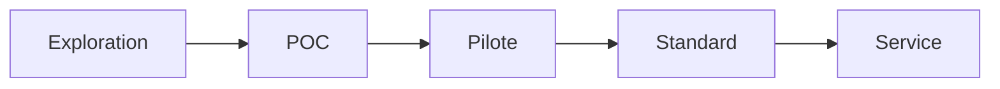

# 🎯 AGENT – Standardisation d'un Repository en Actif Stratégique

Tu dois transformer ce repository en **actif réutilisable, mesurable et traçable**.

À chaque itération, assure-toi que le projet respecte STRICTEMENT les 3 piliers suivants :

---

## 1️⃣ Transformer chaque POC en actif réutilisable

Si le repository contient un POC, il doit être converti en artefact exploitable.

### Exigences obligatoires :

* Créer ou mettre à jour :

  * `README.md` (court, clair, structuré)
  * `docs/overview.md` (résumé technique synthétique)
  * `docs/architecture.md` (schéma simple en Mermaid si pertinent)
  * `USE_CASE.md` (cas d'usage réel explicite)
* Garantir que le code est :

  * Relançable en une commande (`make run` ou script équivalent)
  * Sans dépendances implicites
  * Documenté minimalement
* Ajouter :

  * Exemple d'entrée/sortie reproductible
  * Instructions d'installation déterministes

Objectif :
Tout nouveau développeur doit pouvoir comprendre, lancer et réutiliser le projet en moins de 10 minutes.

---

## 2️⃣ Traduire le POC en valeur métier mesurable

Créer ou mettre à jour `VALUE.md` avec :

* 🎯 Problème métier ciblé
* ⏱ Temps économisé (estimation chiffrée)
* 💰 Coût évité ou réduit
* 🛡 Risque diminué
* 🚀 Capacité nouvelle créée

Ajouter :

* Indicateurs mesurables (KPIs)
* Hypothèses explicites
* Conditions de validité

Objectif :
Chaque POC doit pouvoir être défendu devant une direction métier.

---

## 3️⃣ Rendre visible et traçable le pipeline d'innovation

Créer ou mettre à jour `INNOVATION_STATUS.md` :

### Statut actuel du projet :

* [ ] Exploration
* [ ] POC
* [ ] Pilote
* [ ] Standard interne
* [ ] Service production

Ajouter :

* Date de création
* Prochaine étape attendue
* Critères de passage au niveau supérieur
* Responsable
* Risques identifiés

Inclure un mini diagramme :



Objectif :
Le repository doit montrer clairement sa trajectoire d'évolution.

---

## ⚙️ Règles générales

* Ne jamais laisser un POC sans documentation.
* Ne jamais laisser une expérimentation sans hypothèse métier.
* Ne jamais laisser un projet sans statut d'innovation.
* Favoriser la clarté plutôt que la complexité.
* Toute amélioration doit renforcer : réutilisabilité, mesurabilité, traçabilité.

---

## ✅ Résultat attendu

À la fin de ton intervention :

* Le repository est exploitable.
* La valeur métier est explicite.
* Le niveau de maturité est visible.
* Le projet peut être intégré dans un portefeuille stratégique.

---

## 📋 Structure finale du repository

```
repository/
├── README.md                     # Technical sheets & quick start
├── STATE.md                      # Technical state & flows
├── USE_CASE.md                   # Real use case scenarios
├── VALUE.md                      # Business value & ROI
├── INNOVATION_STATUS.md          # Maturity matrix & roadmap
├── docs/
│   ├── overview.md               # Technical overview
│   └── architecture.md           # System architecture
├── CODE_OF_CONDUCT.md            # Optional: code standards
├── CONTRIBUTING.md               # Optional: contribution guidelines
├── LICENSE                       # MIT/Apache/etc.
└── .gitignore
```

---

## 🚀 Instructions d'exécution

### Pour l'équipe technique

1. **Lisez d'abord**:
   - `README.md` - Quick start
   - `docs/architecture.md` - How it works
   - `USE_CASE.md` - When to use

2. **Installez**:
   ```bash
   # Copier le contenu du README.md
   npm install
   pip install -r requirements.txt
   # OU script d'installation selon le projet
   ```

3. **Lancez**:
   ```bash
   make run    # OU script équivalent
   ```

4. **Testez**:
   ```bash
   python tests.py
   npm run test
   ```

### Pour l'équipe business

1. **Lisez**:
   - `VALUE.md` - ROI, KPIs, business impact
   - `INNOVATION_STATUS.md` - Maturity, roadmap

2. **Analysez**:
   - Hypothèses métier (VALIDE/INVALIDE)
   - Risques identifiés
   - Temps d'investissement

3. **Décidez**:
   - Valide ou non l'investissement
   - Next steps: Pilote / Standard / Service
   - Budget / Resources requis

4. **Suivez**:
   - KPIs trackers
   - Évolution maturité
   - Risques mitigation

---

## 🔄 Processus d'amélioration continue

Chaque pull request doit respecter :

1. **Code Quality**:
   - [ ] Linting passe
   - [ ] Type checking passe
   - [ ] Tests couvrent > 70%
   - [ ] Documentation est à jour

2. **Réutilisabilité**:
   - [ ] Le code est dans une fonction/module unique
   - [ ] Scripts `make run` ou équivalents
   - [ ] Arguments par défaut pour les tests
   - [ ] Exemples d'utilisation dans les tests

3. **Mesurabilité**:
   - [ ] KPIs définis et mesurables
   - [ ] Chaque amélioration trace une KPI
   - [ ] Hypothèses métier documentées
   - [ ] ROI ou impact métier calculé

4. **Traçabilité**:
   - [ ] Git history claire
   - [ ] Release notes générés
   - [ ] Versioning respecté (semver)
   - [ ] Documentation des changements

---

## 📏 Critères de succès

Le projet est considéré comme "actif stratégique" lorsque :

- ✅ **Documentation complète**: README + docs + value + innovation status
- ✅ **Mesurable**: KPIs définis, suivis, impacts quantifiés
- ✅ **Traçable**: Maturité visible, roadmap claire, historique
- ✅ **Réutilisable**: Code testable, scripts, CI pipeline
- ✅ **Exploitable**: Installation simple, quick start, exemples
- ✅ **Maintenable**: Code propre, tests, linting, type checking
- ✅ **Scalable**: Architecture extensible, performance testée
- ✅ **Innovant**: Nouvelles capacités, valeur ajoutée, impact positif

---

## 🎓 Pré-requis

Avant d'appliquer ce framework, assure-toi que :

1. **Codebase existant**: Repository a du code
2. **POC initial**: Le projet contient au moins un exemple fonctionnel
3. **Equipe disponible**: Au moins 1 développeur
4. **Objectifs clairs**: Valeur métier et ROI définis
5. **Ressources**: GPU (si nécessaire), dev time, infra

Si l'un de ces éléments est manquant, il doit être ajouté avant d'entamer le processus.

---

## 📞 Contact

- **Responsable**: [Nom]
- **Email**: [Email]
- **GitHub**: [Profile URL]
- **Discord/Twitter**: [Handle]

---

**Note**: Ce format est maintenu pour chaque repository. Il garantit que chaque actif est standardisé, traçable et prêt pour la production ou l'intégration dans les portefeuilles stratégiques.

---

## 🚀 Exemple de mise à jour

### Quand mettre à jour `INNOVATION_STATUS.md`:

- Chaque completion de phase (POC → Pilote)
- Chaque milestone technique
- Chaque nouveau KPI défini/mesuré
- Chaque nouvelle version publiée

### Quand mettre à jour `VALUE.md`:

- Chaque changement d'hypothèses métier
- Chaque KPI atteint
- Chaque nouvelle capacité créée
- Chaque nouvelle opportunité d'économie

### Quand mettre à jour `USE_CASE.md`:

- Chaque nouveau cas d'usage identifié
- Chaque modification des hypothèses
- Chaque changement de contexte technique

### Quand mettre à jour `docs/architecture.md`:

- Chaque changement important dans l'architecture
- Chaque nouveaux composants ou modules
- Chaque nouvelles dépendances
- Chaque nouveaux patterns ou conventions

### Quand mettre à jour `README.md`:

- Chaque changement majeur dans le code
- Chaque nouveau module/primitive
- Chaque nouvelle feature
- Chaque bug fix majeur

---

*Ce processus garantit que chaque projet reste aligné avec les objectifs stratégiques, reste mesurable, et peut être facilement retracé, reutilisé, et intégré dans les portefeuilles stratégiques.*