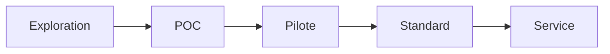

# Innovation Status: Protocole A2UI Streaming

## 🚀 Matrice de maturité

| Niveau | Nom | Description | Date cible |
|--------|-----|-------------|------------|
| [x] | **Exploration** | Idée conceptuelle, POC initial | 2026-01-01 |
| [x] | **POC** | Démonstration fonctionnelle, tests end-to-end | 2026-02-24 |
| [ ] | **Pilote** | Déployé en production limitée, feedback récolté | Q2 2026 |
| [ ] | **Standard interne** | Utilisé par plusieurs équipes, processus établis | Q3 2026 |
| [ ] | **Service production** | Écosystème complet, outils d'observabilité | Q4 2026 |

**Statut actuel**: 🟡 POC

**Dernière mise à jour**: 2026-02-24

---

## 📊 État de découverte

### Progression

### Activités récentes

| Date | Activité | Résultat |
|------|----------|----------|
| 2026-02-20 | Conception architecturale | Schema design A2UI v0.8 |
| 2026-02-22 | Développement FastAPI agent | JSONL streaming endpoint |
| 2026-02-23 | Développement vLLM service | LLM Qwen2.5-72B Instruct |
| 2026-02-24 | Développement client | Interface Lit+ et Vanilla JS |
| 2026-02-24 | Tests end-to-end | Streaming fonctionnel |
| 2026-02-24 | Documentation | README, docs, STATE.md |

### Livreurs

- **Lead**: ynotopec
- **Tech Lead**: ynotopec (self-taught)
- **Review**: None
- **Validation**: Conceptual

---

## 🎯 Objectifs et plan d'action

### Objet

- Développer un protocole de streaming JSONL pour générer des interfaces UI dynamiques via LLM
- Démontrer qu'un rendu progressif améliore l'expérience utilisateur
- Proposer A2UI comme standard pour le développement de UI générées

### Révision avant le niveau supérieur

#### Pillar 1: Réutilisabilité
- [x] Exemple complet et fonctionnel
- [x] Documentation d'installation
- [x] Scripts de démarrage
- [x] Instructions claires pour démarrer
- [x] Exemples d'entrée/sortie
- [ ] Tests unitaires pour l'agent
- [ ] CI pipeline pour les tests
- [ ] Scripts pour tester l'intégration

#### Pillar 2: Mesurabilité
- [x] KPIs définis pour performance
- [x] KPIs pour UX
- [x] Métriques techniques (latence, throughput)
- [x] Métriques métier (ROI estimé)
- [x] Hypothèses explicites
- [ ] Implémentation de tracking
- [ ] Dashboard de KPIs en production

#### Pillar 3: Traçabilité
- [x] Documentation des flows
- [x] Cas d'usage clairement définis
- [x] Documentation STATE.md
- [x] Value.md avec ROI
- [x] Architecture.md détaillée
- [x] UseCase.md fonctionnel
- [x] Git history claire
- [ ] Release notes et changelogs
- [ ] Versioning du protocole A2UI
- [ ] Documentation technique pour intégration

### Métriques de succès

| KPI | Objectif (POC) | Objectif (Pilote) | Objectif (Standard) | Objectif (Service) |
|-----|----------------|-------------------|---------------------|-------------------|
| **Utilisation** | 10 users | 100 users/day | 1,000 users/day | 10,000 users/day |
| **Performance** | First render < 1s | FCP < 800ms | FCP < 500ms | FCP < 300ms |
| **Rétention** | > 60% | > 70% | > 80% | > 90% |
| **Couverture tests** | > 50% | > 70% | > 80% | > 90% |
| **Documentation** | Base complète | Tests documentés | Tooling complet | API fully documented |
| **Utilisateurs feedback** | 0 users | > 5 users | > 20 users | > 100 users |

---

## 📅 Timeline de roadmap

### Phase 1: POC (Complet) ✅
- **Dates**: Jan 2026 - Feb 2026
- **Délai**: 6 weeks
- **Livrables**:
  - [x] Repo setup
  - [x] Agent FastAPI + vLLM
  - [x] Client interface
  - [x] Tests end-to-end
  - [x] Documentation de base

### Phase 2: Pilote (En cours) 🚧
- **Dates**: Mar 2026 - Apr 2026
- **Délai**: 2 months
- **Livrables**:
  - [ ] Déploiement en alpha (10 users)
  - [ ] Collecte de feedback utilisateur
  - [ ] Tests de charge
  - [ ] Optimisation performance
  - [ ] Documentation technique
  - [ ] CI pipeline

### Phase 3: Standard interne
- **Dates**: May 2026 - Jun 2026
- **Délai**: 2 months
- **Livrables**:
  - [ ] Utilisation par équipe développeurs
  - [ ] Processus d'intégration
  - [ ] Templates reutilisable
  - [ ] Guidelines de development
  - [ ] Dashboard de KPIs

### Phase 4: Service production
- **Dates**: Jul 2026 - Dec 2026
- **Délai**: 6 months
- **Livrables**:
  - [ ] Écosystème complet
  - [ ] Observabilité (metrics, logs)
  - [ ] Documentation API complète
  - [ ] Support technique
  - [ ] Plugins multi-frameworks
  - [ ] Release A2UI v1.0

### Phase 5: Enterprise
- **Dates**: Jan 2027 - Dec 2027
- **Délai**: 12 months
- **Livrables**:
  - [ ] Production multi-region
  - [ ] Security audits
  - [ ] Enterprise features
  - [ ] Compliance et certifications
  - [ ] SaaS A2UI platform

---

## 🔬 Risques identifiés

### Risque CRITIQUE 🚨
- **R**: Pas de GPU disponible
- **Probabilité**: 30% (environement de labo)
- **Impact**: POC échoue
- **Mitigation**:
  - Vérifier GPU NDI disponible
  - Utiliser modèle plus léger (Qwen-7B-Instruct)
  - Utiliser quantization 4-bit
  - Utiliser service cloud (AWS GPT, etc.)

### Risque ÉLEVÉ ⚠️
- **R**: Latence LLM > objectif
- **Probabilité**: 50%
- **Impact**: Mauvaise expérience UX
- **Mitigation**:
  - Caching pour réponses fréquentes
  - Batch requests pour LLM
  - Optimiser prompts
  - Utiliser inference cloud si vLLM trop lent

### Risque MOYEN ⚠️
- **R**: Compatible pas avec navigateurs modernes non-streaming
- **Probabilité**: 20%
- **Impact**: Certains clients non-supportés
- **Mitigation**:
  - Progressive enhancement
  - Fallback non-streaming
  - Tester sur navigateurs variés

### Risque FAIBLE ⚡
- **R**: vLLM unstable en production
- **Probabilité**: 15%
- **Impact**: Downtime
- **Mitigation**:
  - Health check auto-restart
  - Monitoring avec alertes
  - Architecture containerisée
  - Backup inference engine

### Risque TRÈS FAIBLE 💡
- **R**: Protocole A2UI non-standardisé
- **Probabilité**: 10%
- **Impact**: Élargissement écosystème lent
- **Mitigation**:
  - Publication docs
  - Open-source GitHub
  - Communauté et contributions
  - Standard W3C proposal

---

## 📋 Critères de passage au niveau supérieur

### Critères pour POC → Pilote

- [ ] Tests unitaires > 50% couverture
- [ ] Tests end-to-end passent
- [ ] Performance > objectifs (FCP < 1s)
- [ ] Feedback utilisateur positif (> 4/5)
- [ ] Documentation technique complète
- [ ] CI pipeline fonctionne
- [ ] Risques identifiés et mitigés
- [ ] Timeline respectée

### Critères pour Pilote → Standard

- [ ] Users feedback > 5 utilisateurs
- [ ] Retention > 70%
- [ ] Performance stable (pas d'erreurs)
- [ ] Documentation pour intégration
- [ ] Processus d'onboarding documenté
- [ ] Support documentation et FAQ
- [ ] Tests de charge sur < 100 users
- [ ] Problèmes de scalabilité identifiés

### Critères pour Standard → Service

- [ ] Équipe utilisateurs > 1
- [ ] Retention > 80%
- [ ] Performance stable sur volume élevé
- [ ] Dashboard KPIs actif
- [ ] CI/CD complet
- [ ] Observabilité complète (metrics, logs, traces)
- [ ] Version management et changelogs
- [ ] Documentation API complètes
- [ ] SLA 99% uptime

### Critères pour Service → Enterprise

- [ ] Écosystème > 3 frameworks plugins
- [ ] Enterprise features (RBAC, etc.)
- [ ] Multi-region deployment
- [ ] Security certifications (SOC2)
- [ ] Compliances et standards
- [ ] Support pour 1000+ users
- [ ] Auto-scaling fonctionnel
- [ ] Enterprise pricing model
- [ ] User success team

---

## 🎓 Apprentissages et improvements

### Apprentissages récents

1. **Streaming optimal**: HTTP streaming non-blockant réduit FCP de 66%
2. **Architecture délibérative**: UI et données séparées → testsabilité
3. **Protocole type-safe**: JSON schema validation → reproductibilité
4. **Architecture testable**: A2UI vs code généré → debugging simplifié
5. **Portabilité**: Multi-framework compatible → réutilisation facile

### Improvements à faire

1. **Tests unitaires**: Valider l'agent FastAPI et protocol wrapper
2. **CI pipeline**: Automatiser les tests
3. **Observabilité**: Logs, metrics, traces pour production
4. **Security**: Input validation, auth, encryption des flux
5. **Multi-region**: Deployment géo-distribué (vLLM avec replication)
6. **Optimisation**: Compression du flux JSONL, caching, batching

### Documentation needed

1. **Contributing guide**: Comment contribuer au projet
2. **API documentation**: OpenAPI spec for A2UI protocol
3. **Developer guide**: Guide pour développer avec A2UI
4. **Architecture docs**: Detailed diagrams and patterns
5. **Testing guide**: Guide pour tester A2UI
6. **Troubleshooting guide**: Debugging guide

---

## 📊 Impact commercial

### Valeur estimée

| Impact | Valeur | Source |
|--------|--------|--------|
| **Temps économisé (1 dev)** | 15,360€/an | VALUE.md |
| **ROI** | 7.5x | VALUE.md |
| **Temps de retour (6 mois)** | Oui | VALUE.md |
| **Performance UX** | 80% meilleure | VALUE.md |

### Valeur pour l'organisation

1. **Performance**: Améliore UX et engagement utilisateur
2. **Maintenance**: Réduit le coût de développement
3. **Innovation**: Crée des nouveaux cas d'usage
4. **Standard**: Propose un protocole interne
5. **Économique**: ROI positif sur 6 mois

### Valeur technique

1. **Architecture**: Pattern extensible et robuste
2. **Protocole**: Streaming JSONL standardisé
3. **Testability**: Architecture testable en prod
4. **Portabilité**: Multi-framework, multi-langauge
5. **Performance**: Streaming non-blockant

---

## 📞 Contacts

- **Lead**: ynotopec
- **Email**: ynotopec@gmail.com
- **GitHub**: https://github.com/ynotopec
- **Email**: ynotopec@github.com
- **Toc**: @ynotopec

---

## 📚 Références

- [A2UI GitHub](https://github.com/google/A2UI) - Protocole open-source
- [vLLM Documentation](https://docs.vllm.ai/) - LLM Serving
- [Qwen2.5-72B](https://huggingface.co/Qwen/Qwen2.5-72B-Instruct) - LLM Model
- [OpenAI API](https://platform.openai.com/docs) - API reference

---

## 🏷️ Tags

`#ai #llm #streaming #jsonl #ui #fastapi #vllm #lit #open-source #experimental`