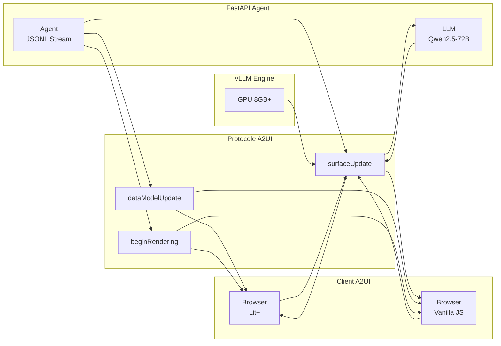
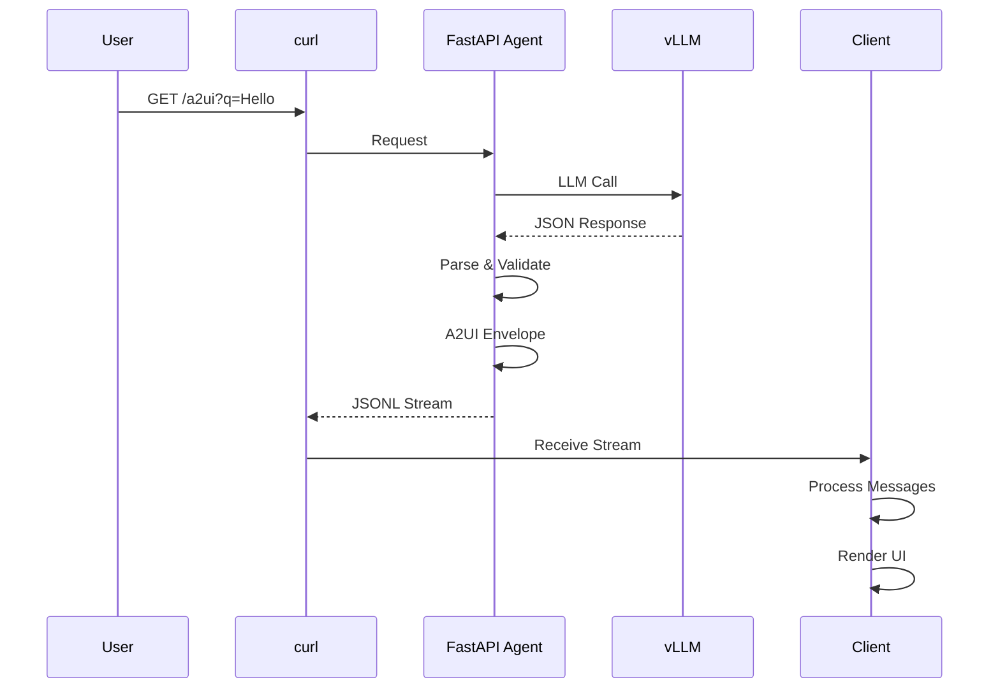

# Architecture Système A2UI

## Vue d'ensemble



## Architecture par composants

### 1. FastAPI Agent (`agent/main.py`)

```
┌─────────────────────────────────────┐
│        FastAPI Application          │
├─────────────────────────────────────┤
│  GET /a2ui?q=query                  │
│      ↓                              │
│  ┌────────────────────────────┐    │
│  │   LLM Generation           │    │
│  │  - Qwen2.5-72B-Instruct    │    │
│  │  - Temperature: 0.2        │    │
│  │  - JSON Schema Validation  │    │
│  └────────────────────────────┘    │
│      ↓                              │
│  ┌────────────────────────────┐    │
│  │   A2UI Protocol            │    │
│  │  - surfaceUpdate           │    │
│  │  - dataModelUpdate         │    │
│  │  - beginRendering          │    │
│  └────────────────────────────┘    │
│      ↓                              │
│  JSONL Stream Output                │
└─────────────────────────────────────┘
```

### 2. vLLM Engine

```
┌─────────────────────────────────────┐
│       vLLM Server                   │
├─────────────────────────────────────┤
│  Port: 8000                          │
│  Model: Qwen2.5-72B-Instruct         │
│  GPU: NVIDIA (8GB+ VRAM)             │
│  dtype: auto (8-bit quantization)    │
└─────────────────────────────────────┘
```

### 3. Protocole A2UI v0.8

Le flux JSONL contient typiquement 3 messages:

| Message | Type | Description |
|---------|------|-------------|
| `surfaceUpdate` | Structure | Définit les composants UI et leurs bindings |
| `dataModelUpdate` | Données | Met à jour les valeurs bindées via JSON Pointer |
| `beginRendering` | Système | Signale au client que le rendu peut commencer |

**Exemple de flux:**
```json
{"surfaceUpdate": {"surfaceId": "...", "components": [...]}}
{"dataModelUpdate": {"surfaceId": "...", "set": [{"path": "/view/title", "valueString": "..."}]}}
{"beginRendering": {"surfaceId": "..."}}
```

### 4. Architecture de données

```
┌──────────────┐
│  User Query  │
└──────┬───────┘
       │
       ▼
┌────────────────────────────────────┐
│     Agent FastAPI                  │
├────────────────────────────────────┤
│  ┌──────────────────────────────┐  │
│  │  JSON Schema Validation       │  │
│  │  AgentData Model              │  │
│  └──────────────────────────────┘  │
│       ↓                            │
│  ┌──────────────────────────────┐  │
│  │  A2UI Protocol Envelope       │  │
│  │  - surfaceUpdate              │  │
│  │  - dataModelUpdate            │  │
│  │  - beginRendering             │  │
│  └──────────────────────────────┘  │
└──────┬─────────────────────────────┘
       │
       ▼
┌──────────────┐
│  JSONL Stream│
│  (HTTP Stream)│
└──────┬───────┘
       │
       ▼
┌──────────────┐
│  Client      │
│  - Lit+      │
│  - Vanilla JS│
└──────────────┘
```

## Flows d'exécution

### Flow d'initialisation



### Flow de streaming

```
Client (curl) ──► Agent (FastAPI) ──► vLLM (LLM Generation)
                     │                      │
                     │                      │
                     └─► Agent Protocol Processing
                            │
                            ├─► surfaceUpdate ──► Client
                            │
                            ├─► dataModelUpdate ──► Client
                            │
                            └─► beginRendering ──► Client
```

## Technologies et dépendances

### Backend
- **FastAPI** (0.115.6) - API Framework
- **vLLM** - LLM Serving
- **Qwen2.5-72B** - LLM Model
- **OpenAI SDK** - LLM Client

### Frontend
- **Lit+** (Stencil) - UI Framework optionnel
- **Vanilla JS** - Client principal
- **HTTP Streaming** - Protocol de communication

### Infrastructure
- **Docker** - Containerisation
- **NVIDIA GPU** - Compute
- **vLLM** - LLM Inference Engine

## Patterns architecturaux

### 1. Architecture Découplée

- UI Structure (surfaceUpdate) séparée des Données (dataModelUpdate)
- Le client ne génère pas les composants, il les reçoit
- Le modèle change indépendamment du DOM

### 2. Streaming Non-Blockant

- JSONL flux envoyé progressivement (ne bloque pas le LLM)
- Client reçoit les messages séquentiellement
- Rendu incrémental possible

### 3. Protocole Déclaratif

- Pas de code généré côté client
- Tout est décrit de manière déclarative
- Compatible avec différents renderers

## Scalabilité et performances

| Point critique | Optimisation |
|----------------|--------------|
| LLM Generation | vLLM caching, batch requests |
| Streaming Response | Keep-alive HTTP streaming |
| Client Rendering | Lazy loading, virtual DOM |
| GPU Memory | 8-bit quantization (dtype=auto) |

## Sécurité

- **No sensitive data in code**: Config via Docker env vars
- **Model isolation**: vLLM container separated
- **API rate limiting**: Not implemented (test env)
- **Input validation**: Query parameters validated

## Maintenance et évolution

- **Backward compatibility**: A2UI v0.8 messages stable
- **Extensibility**: New messages types supported
- **Debugging**: Raw JSONL streaming to inspect
- **Testing**: End-to-end curl tests included